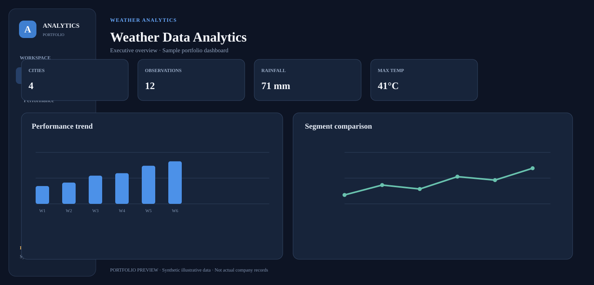

> Preview illustration built from synthetic sample data; it is not a screenshot of a live Power BI report.

# Weather Data Analytics

## Project overview
Analyze daily temperature, rainfall, humidity, and weather conditions across locations.

**Domain:** Weather and climate reporting  
**Tools:** PostgreSQL and SQL

## Business questions
- Which city recorded the highest temperatures?
- Which locations received the most rainfall?
- How did humidity and weather conditions vary?
- What were the rolling temperature patterns?

## Repository structure
- `analysis.sql` — table creation, synthetic sample observations, and eight analytical queries.

## How to run
1. Open PostgreSQL using pgAdmin or psql.
2. Select a practice database.
3. Run `analysis.sql` from top to bottom.
4. Review the result sets and adapt the queries to a larger dataset.

## SQL concepts
Aggregations, CASE expressions, date grouping, window functions, ranking, and rolling averages.

## Data note
The included observations are synthetic illustrative records for learning. They are not live forecasts or official climate records.

## Suggested extension
Replace sample rows with an appropriately licensed weather dataset, validate its source and coverage, then build a dashboard with clear metric definitions.

## Author
Omkar S. Kshirsagar
